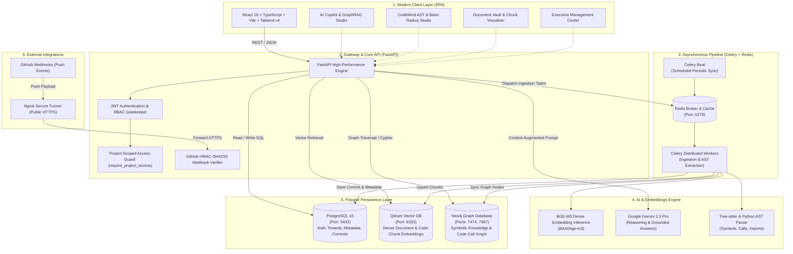
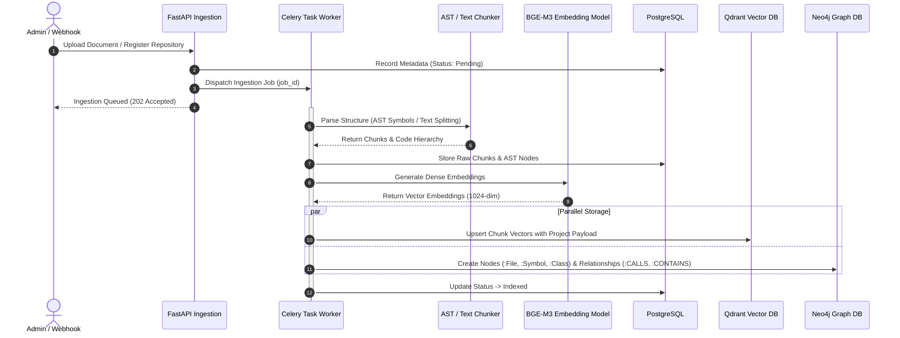
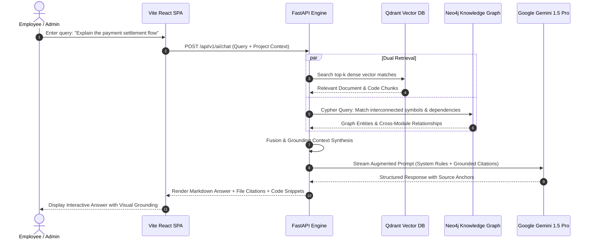
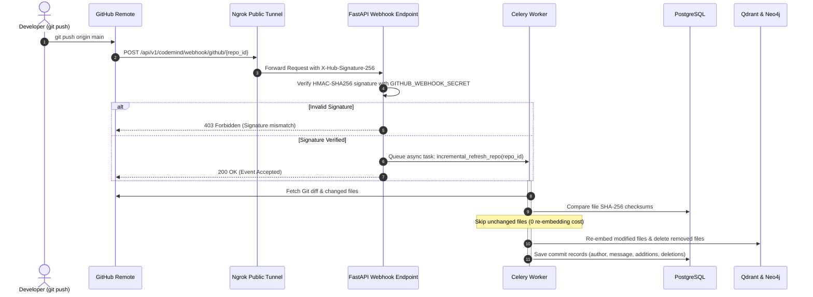

# ⚡ MemoraAI — Enterprise Organizational Memory & CodeMind

<div align="center">

[](https://fastapi.tiangolo.com)
[](https://react.dev)
[](https://www.typescriptlang.org)
[](https://tailwindcss.com)
[](https://www.postgresql.org)
[](https://neo4j.com)
[](https://qdrant.tech)
[](https://redis.io)
[](https://docs.celeryq.dev)
[](https://ai.google.dev)
[](https://docs.google.com/presentation/d/1Yt1jjyMTniTYk-NyfKfL4FZYdZumJs-i/edit?usp=sharing&ouid=105436163698430899164&rtpof=true&sd=true)

**Enterprise Organizational Memory + CodeMind** is a next-generation corporate intelligence platform designed to eliminate institutional knowledge loss and accelerate engineering understanding. Combining multi-tenant **GraphRAG** (Knowledge Graphs + Vector Search) with an AST-driven **CodeMind Studio**, it bridges the gap between high-level business documents and low-level code implementation.

[📽 Project Presentation (PPT)](https://docs.google.com/presentation/d/1Yt1jjyMTniTYk-NyfKfL4FZYdZumJs-i/edit?usp=sharing&ouid=105436163698430899164&rtpof=true&sd=true) •
[System Architecture](#-system-architecture) •
[Data & Execution Flows](#-data--execution-flows) •
[Quickstart Guide](#-quickstart-guide) •
[CodeMind & Webhooks](#-codemind--real-time-git-webhooks) •
[API Reference](#-interactive-api-reference)

---

</div>

## 📽 Project Presentation (Pitch Deck)

> 📊 **Explore the official project slide deck covering problem statement, system architecture, core innovations, and live demonstration:**  
> 👉 **[Open Google Slides Presentation](https://docs.google.com/presentation/d/1Yt1jjyMTniTYk-NyfKfL4FZYdZumJs-i/edit?usp=sharing&ouid=105436163698430899164&rtpof=true&sd=true)**

---

## 🌟 Key Features

| Module | Description |
| :--- | :--- |
| 🧠 **Organizational Memory & GraphRAG** | Unifies enterprise PDFs, text files, policies, and knowledge into a dual-layer index: dense vectors in **Qdrant** (`BAAI/bge-m3`) and symbolic entities in **Neo4j**, synthesized by **Google Gemini 1.5 Pro**. |
| ⚡ **CodeMind AST Studio** | Real-time Abstract Syntax Tree (AST) code analysis via Python AST and Tree-sitter. Maps function calls, class hierarchies, business-rule-to-code traceability, and blast-radius impact analysis. |
| 🏢 **Multi-Tenant RBAC Security** | Strict data isolation across organizations and projects. Includes granular roles (`Admin`, `Employee`), project-level access tokens, and server-side authorization filters. |
| 🔄 **Real-Time Git Webhooks** | Automatically monitors GitHub repositories. Ingests commits incrementally on `git push`, performing SHA-256 checksum delta-checks and updating vectors and graph nodes asynchronously via **Celery**. |
| 🔍 **Multi-Modal Spotlight Search** | Sub-millisecond hybrid search combining dense semantic embeddings with strict organizational metadata filtering and interactive result gauges. |
| 📊 **Modern Executive UI** | Built on React 19, TypeScript, and TailwindCSS v4 with glassmorphism, responsive data visualizers, AST inspection panels, and interactive call graphs. |

---

## 🏛 System Architecture

The platform is designed around a decoupled, highly-available 3-tier microservices architecture backed by polyglot persistence:



---

## 🔄 Data & Execution Flows

### 1. Document & Code Ingestion Pipeline
When documents or codebases are uploaded or synced, they undergo a multi-stage enrichment pipeline:



---

### 2. Hybrid GraphRAG Query Flow
Queries blend vector similarity with symbolic graph traversal for complete, hallucinatory-free context:



---

### 3. Incremental Git Push Webhook Flow
Code updates trigger real-time, compute-efficient incremental indexing:



---

## 📁 Repository Directory Structure

```text
Hackday/
├── backend/                        # FastAPI Backend Application
│   ├── alembic/                    # Database Migrations & Versioning
│   ├── app/
│   │   ├── api/v1/                 # REST Route Handlers (Auth, AI, CodeMind, Docs, Search)
│   │   ├── core/                   # Security, JWT, CORS, Config, Exceptions
│   │   ├── db/                     # SQLAlchemy Models & Sessions
│   │   ├── schemas/                # Pydantic Schemas for Validation
│   │   ├── services/               # Business Logic, GraphRAG, AST Parsers, Search
│   │   └── workers/                # Celery Application, Tasks & Beat Schedules
│   ├── scripts/                    # Database seed scripts (setup_demo.py)
│   ├── .env.example                # Backend Environment Template
│   ├── CODEMIND_SETUP.md           # CodeMind In-Depth Setup Instructions
│   └── requirements.txt            # Python Dependencies
│
├── frontend/                       # React 19 Frontend Application
│   ├── src/
│   │   ├── components/             # Reusable UI Components (Cards, Modals, Layout)
│   │   ├── layouts/                # AppLayout, Navigation, Header
│   │   ├── pages/                  # Chat, CodeMind, Documents, Search, Admin, Org
│   │   ├── services/               # Axios API Clients
│   │   └── index.css               # Design Tokens, Glassmorphism, Google Fonts
│   ├── index.html                  # HTML5 Entry Point
│   ├── package.json                # Frontend Dependencies
│   └── vite.config.ts              # Vite Bundler Configuration
│
├── datasets/                       # Sample Codebases (TechNova PayFlow)
├── docker-compose.yml              # Multi-Service Infrastructure (PostgreSQL, Neo4j, Qdrant, Redis)
└── README.md                       # Comprehensive Project Documentation
```

---

## 🚀 Quickstart Guide

Follow these steps to run the complete environment on your local machine.

### Prerequisites

Ensure you have the following installed:
- [Docker Desktop](https://www.docker.com/products/docker-desktop/) (running)
- [Python 3.11+](https://www.python.org/downloads/)
- [Node.js 18+](https://nodejs.org/) & `npm`
- [Git](https://git-scm.com/)
- [Ngrok](https://ngrok.com/) (Optional: required for GitHub push webhooks)

---

### Step 1: Start Infrastructure with Docker

Launch PostgreSQL, Neo4j, Qdrant, and Redis with a single command:

```powershell
docker compose up -d
```

#### Container Status & Port Mappings:
| Container | Service | Host Port | Purpose |
| :--- | :--- | :--- | :--- |
| `eme-postgres` | PostgreSQL 16 | **`5433`** | Primary relational database |
| `eme-neo4j` | Neo4j Graph DB | **`7474`**, **`7687`** | Graph browser (`7474`) & Bolt connection (`7687`) |
| `eme-qdrant` | Qdrant Vector DB | **`6333`** | Vector similarity collection store |
| `eme-redis` | Redis 7 | **`6379`** | Celery task message broker & cache |

Verify all containers are healthy:
```powershell
docker ps
```

---

### Step 2: Configure Environment Variables

#### Backend Configuration:
Navigate to `backend` and create your `.env` file:

```powershell
cd backend
copy .env.example .env
```

Open `backend/.env` and ensure the database credentials match Docker:
```dotenv
POSTGRES_HOST=localhost
POSTGRES_PORT=5433
POSTGRES_DB=enterprise_memory
POSTGRES_USER=postgres
POSTGRES_PASSWORD=postgres

NEO4J_URI=bolt://localhost:7687
NEO4J_USER=neo4j
NEO4J_PASSWORD=change-me-strong-password

QDRANT_HOST=localhost
QDRANT_PORT=6333
REDIS_URL=redis://localhost:6379/0

JWT_SECRET=super-secret-jwt-key-replace-in-production-12345
GOOGLE_API_KEY=your-gemini-api-key-here
GITHUB_WEBHOOK_SECRET=technova_webhook_secret_2026
```

#### Frontend Configuration:
Navigate to `frontend` and create your `.env` file:

```powershell
cd ../frontend
copy .env.example .env
```
Ensure `VITE_API_URL=http://localhost:8000/api/v1` in `frontend/.env`.

---

### Step 3: Backend Setup & Database Migration

In a PowerShell terminal:

```powershell
cd backend

# 1. Create and activate Python virtual environment
python -m venv .venv
.\.venv\Scripts\Activate.ps1

# 2. Install dependencies
python -m pip install --upgrade pip
pip install -r requirements.txt

# 3. Run database migrations
alembic upgrade head

# 4. Seed demo organization, admin user, and sample data
python -m scripts.setup_demo
```

---

### Step 4: Run the Backend Services

#### Terminal 1: Start FastAPI REST API Server
```powershell
cd backend
.\.venv\Scripts\Activate.ps1
uvicorn app.main:app --reload --host 0.0.0.0 --port 8000
```
> 🌐 **API is live at:** `http://localhost:8000`  
> 📖 **Interactive Swagger Docs:** `http://localhost:8000/docs`

#### Terminal 2: Start Celery Worker (Asynchronous Tasks)
```powershell
cd backend
.\.venv\Scripts\Activate.ps1
celery -A app.workers.celery_app:celery_app worker --loglevel=INFO --pool=solo
```

#### Terminal 3: Start Celery Beat (Periodic Sync Schedules)
```powershell
cd backend
.\.venv\Scripts\Activate.ps1
celery -A app.workers.celery_app:celery_app beat --loglevel=INFO
```

---

### Step 5: Run the Frontend UI

Open a new terminal for the React 19 client:

```powershell
cd frontend
npm ci
npm run dev
```

> 💻 **Frontend Web App is live at:** `http://localhost:5173` (or `http://localhost:5174`)

---

## 🔑 Demo Login Credentials

The seed script creates the following pre-configured tenant accounts under **TechNova Organization**:

| Role | Email Address | Password | Permissions |
| :--- | :--- | :--- | :--- |
| **Administrator** | `admin@technova.com` | `Admin@123` | Full access: User management, CodeMind indexing, connector configurations, system settings. |
| **Employee** | `employee@technova.com` | `Employee@123` | Project workspace: AI Chat, AST CodeMind Explorer, Document Search, Knowledge Graph exploration. |

---

## ⚡ CodeMind & Real-Time Git Webhooks

CodeMind allows indexing both local repositories and live GitHub repositories.

### Indexing a Local Codebase:
1. Log in as `admin@technova.com`.
2. Go to **Admin Center** -> **CodeMind Repositories**.
3. Create a repository source with:
   - **Provider:** `local`
   - **Path:** `../datasets/technova/payflow`
   - **Default Branch:** `main`
4. Click **Validate** and **Index Repository**.

### Setting Up Live GitHub Push Webhooks:

1. **Expose your local FastAPI server** using Ngrok:
   ```powershell
   ngrok http 8000
   ```
   Note the forwarding HTTPS URL, e.g.: `https://your-domain.ngrok-free.dev`.

2. **Configure Webhook on GitHub**:
   - Go to your repository on GitHub -> **Settings** -> **Webhooks** -> **Add webhook**.
   - **Payload URL:** `https://your-domain.ngrok-free.dev/api/v1/codemind/webhook/github/{repository_id}`  
     *(Replace `{repository_id}` with the ID from the Admin Center, e.g., `2`)*
   - **Content type:** `application/json`
   - **Secret:** `technova_webhook_secret_2026` *(Must match `GITHUB_WEBHOOK_SECRET` in `backend/.env`)*
   - **Events:** Select **Just the push event**.
   - Click **Add Webhook**.

3. **Verify:** When you push new code to your repository, GitHub triggers the webhook. Celery immediately captures the push event, runs differential SHA-256 checks, and updates the vector and graph indices automatically.

---

## 📖 Interactive API Reference

Once FastAPI is running, navigate to `http://localhost:8000/docs` for interactive Swagger documentation.

| Category | Endpoint | Method | Description |
| :--- | :--- | :---: | :--- |
| **Auth** | `/api/v1/auth/login` | `POST` | Authenticate and obtain JWT access token |
| **Auth** | `/api/v1/auth/me` | `GET` | Get current user profile and tenant details |
| **AI Chat** | `/api/v1/ai/chat` | `POST` | Execute hybrid GraphRAG query with citations |
| **CodeMind** | `/api/v1/codemind/repositories` | `GET/POST` | List and register repositories for indexing |
| **CodeMind** | `/api/v1/codemind/query/search` | `POST` | Semantic code search across indexed symbols |
| **CodeMind** | `/api/v1/codemind/query/architecture` | `POST` | High-level module architecture breakdown |
| **CodeMind** | `/api/v1/codemind/query/impact` | `POST` | Blast-radius impact analysis of code symbols |
| **CodeMind** | `/api/v1/codemind/webhook/github/{id}` | `POST` | Public GitHub push event receiver |
| **Documents**| `/api/v1/documents` | `GET/POST` | Upload and list organizational knowledge documents |
| **Search** | `/api/v1/search` | `POST` | Unified semantic spotlight search |

---

## 🧪 Testing & Validation

Run the following test commands to ensure code quality:

```powershell
# 1. Backend syntax and compilation validation
cd backend
python -m compileall app scripts

# 2. Database migration verification
alembic current
alembic check

# 3. Frontend production build validation
cd ../frontend
npm run build
```

---

## 🛡 Security & Best Practices

- **Zero-Leak Multi-Tenancy:** Every retrieval call is protected by the `require_project_access` dependency. Users cannot query repositories or documents outside their assigned projects.
- **HMAC Signature Verification:** GitHub webhooks validate payloads using `hmac-sha256` matching against `GITHUB_WEBHOOK_SECRET`.
- **Stateless Authentication:** Encrypted JWT tokens with configurable TTL (`JWT_EXPIRE_MINUTES`).

---

## 📄 License

This project is licensed under the MIT License — see the [LICENSE](LICENSE) file for details.
